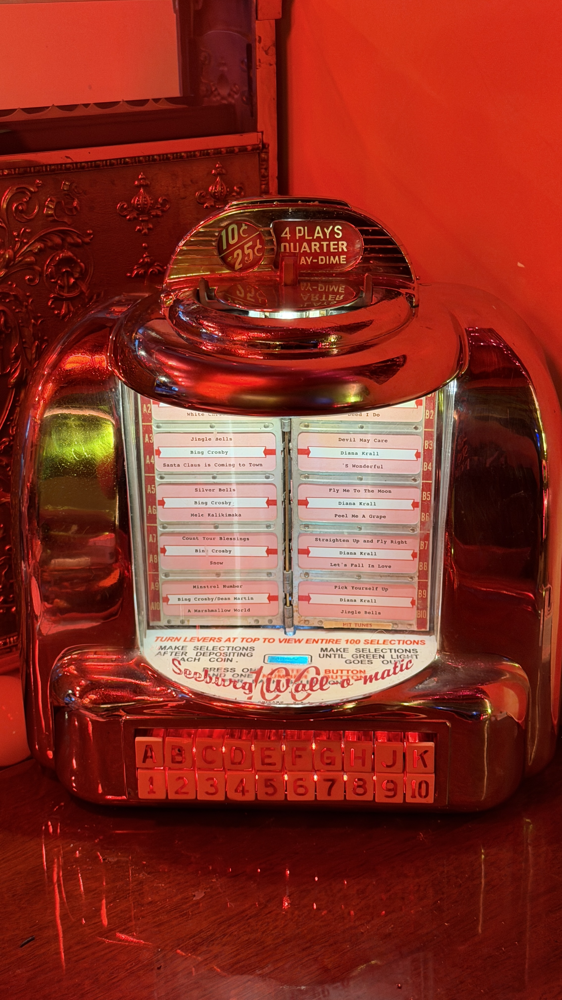

# Seeburg Now Playing Pico



MicroPython firmware for the Raspberry Pi Pico 2 W used as the Seeburg
Wallbox pulse recorder/decoder and direct [Now Playing API client](https://github.com/teacherguy2020/now-playing).

[Now Playing](https://github.com/teacherguy2020/now-playing) is the music-control
application that provides the web interfaces and API for library search,
playback, queue management, and moOde/MPD integration.

## Current status

`main.py` is now the deployed LIVE firmware. It captures both GPIO edges,
collapses them into electrical envelopes, validates and decodes a selection,
then sends the resulting playlist number to Now Playing. Invalid or overflowed
captures are rejected without making an API request.

RECORD and DRY_RUN were commissioning plans; they are not runtime modes in the
current file. Use the Pico diagnostic page and the Now Playing API's explicit
`dryRun` request from a separate commissioning client when a non-mutating test
is needed.

## Hardware and service

- Device: Raspberry Pi Pico 2 W
- Current DHCP address: `10.0.0.118`
- Now Playing hardware gateway: `10.0.0.4:3103`
- Now Playing API: `POST http://10.0.0.4:3103/integrations/seeburg/selection`
- API payload: `{"number": 1}` through `{"number": 100}`

The Pico sends a playlist number. The Now Playing API validates the request and
looks up that position in the `Seeburg Playlist`. If playback is stopped or
paused, the API clears the live queue, adds the selected track, and starts it;
if playback is already active, it appends the selected track without
interrupting playback.

## Final hardware wiring

The Seeburg's approximately 25 VAC selection signal is isolated from the Pico
through a DB107 full-wave bridge and an EL817/PC817-type optocoupler module.
The as-built circuit uses an external 10 kΩ, 1/2-watt series resistor on the
module input and connects the isolated output to GP15. See the
[as-built wiring record](docs/seeburg-wiki/as-built-wiring.md) for the exact
terminal and physical-pin connections. **Never connect Seeburg COMMON to Pico
GND.**

## Local setup

Copy `secrets.example.py` to `secrets.py` and fill in the Wi-Fi credentials,
the existing `TRACK_KEY`, and a long random `OTA_TOKEN`. `secrets.py` is
ignored by Git and must not be committed. Do not reuse the track key as the
OTA token.

## OTA updates

The firmware accepts a complete `main.py` replacement at `POST /ota` when the
request includes:

```http
Authorization: Bearer <OTA_TOKEN>
Content-Type: text/plain
```

The upload is limited to 64 KiB, compiled before installation, staged through
`main.new.py`, and preserves the previous firmware as `main.backup.py`. A
successful upload returns `200` and reboots the Pico. Missing or incorrect
authorization returns `401`; an absent token disables OTA and returns `503`.

Example, with the token supplied by the local shell rather than saved in the
command history:

```sh
curl --fail --data-binary @main.py \
  -H "Authorization: Bearer ${SEEBURG_OTA_TOKEN}" \
  -H 'Content-Type: text/plain' \
  http://10.0.0.118/ota
```

After an OTA update, wait for Wi-Fi to reconnect and confirm the diagnostic
page is available. The page reports the last OTA result without displaying the
token. USB/MicroPico remains the recovery path if an update fails.

The firmware is configured with `MODE = "LIVE"`. Before connecting the
Wallbox, verify the playlist mapping with `GET /integrations/seeburg/playlist`
or a `dryRun` API request. A valid physical selection then changes playback
according to the stopped-versus-playing behavior above.

The diagnostic page also provides an additional test-selection interface. Pause
auto-refresh before testing, choose a letter from the letter bank, then choose
a number from the number bank. That explicit page action sends the resulting
selection through the same authenticated API; physical Wallbox captures remain
LIVE throughout. Letter selection is client-side and does not reload the page.
After both controls are highlighted, the number action submits once and the
page redirects back to the diagnostic root so auto-refresh cannot repeat it.
